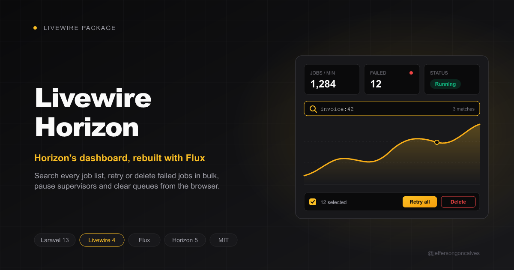

<div class="filament-hidden">



</div>

# Livewire Horizon

[](https://packagist.org/packages/jeffersongoncalves/livewire-horizon)
[](https://github.com/jeffersongoncalves/livewire-horizon/actions?query=workflow%3ATests+branch%3A1.x)
[](https://packagist.org/packages/jeffersongoncalves/livewire-horizon)

The [Laravel Horizon](https://laravel.com/docs/horizon) dashboard rewritten with Livewire and [Flux](https://fluxui.dev), in Horizon's own colors, plus the things the original dashboard is missing:

- **Search everywhere.** Pending, completed, silenced and failed jobs can be searched by job class, ID, queue, tag or anything in the payload, and filtered by queue. (Horizon only lets you filter failed jobs by tag, and completed jobs not at all.)
- **Bulk actions on failed jobs.** Retry or delete the selected jobs, or every job matching the current search.
- **Supervisor controls.** Pause, continue or restart a whole Horizon instance or a single supervisor from the dashboard.
- **Clear a queue.** Delete every job waiting in a queue (`horizon:clear`) from the workload table or the pending jobs page.

Everything else matches Horizon: dashboard, workload, monitored tags, metrics with charts, batches and job details.

## Compatibility

| Package | Livewire |
|---------|----------|
| 1.x     | 3.x      |
| 2.x     | 4.x      |

## Requirements

- Laravel Horizon 5.40+
- A [Flux Pro](https://fluxui.dev/pricing) license: the dashboard uses Flux Pro's charts and tabs. Add the Flux repository and your credentials first:

```bash
composer config repositories.flux composer https://composer.fluxui.dev
composer config http-basic.composer.fluxui.dev your-email your-license-key
```

## Installation

```bash
composer require jeffersongoncalves/livewire-horizon:^1.0
```

Open `/livewire-horizon`. Horizon's own dashboard keeps working at `/horizon`.

The stylesheet ships prebuilt and is inlined in the page like Horizon's, so the app needs no Vite or Tailwind changes.

## Access

The dashboard uses the same gate as Horizon: whoever can open `/horizon` (your `viewHorizon` gate, or `Horizon::auth()`) can open this one. The check runs on every Livewire request, not only on the first page load.

## Configuration

```bash
php artisan vendor:publish --tag="livewire-horizon-config"
```

```php
return [
    'path' => env('LIVEWIRE_HORIZON_PATH', 'livewire-horizon'),

    'domain' => env('LIVEWIRE_HORIZON_DOMAIN'),

    'middleware' => ['web'],

    // How many stored jobs one search (or "retry/delete all matching") looks at.
    'search_limit' => 5000,

    // Dashboard refresh interval, in seconds.
    'poll' => 5,
];
```

## How it works

- Pages read Horizon's own repositories and reuse its controllers, so the numbers are the same ones Horizon shows.
- Horizon keeps jobs in Redis without a search index, so search scans the stored jobs (newest first) up to `search_limit`. How many there are depends on your `horizon.trim` settings.
- Pause, continue and restart go through Horizon's command queue in Redis, the same channel Horizon uses to talk to its supervisors. Unlike `horizon:pause`, which sends a Unix signal, this works when the web server and Horizon run on different servers or as different users. The command runs on the supervisor's next loop, within a few seconds.
- Retry dispatches Horizon's `RetryFailedJob`; delete does what `horizon:forget` does. "Retry all" and "Delete all" run in a queued job, so thousands of jobs don't time out the request. Without a filter they cover every stored failed job, not just `search_limit`.
- Clearing a queue uses the connection of the supervisor that works it in the current environment (`horizon.environments` merged with `horizon.defaults`).

## Testing

```bash
composer test
```

To see the dashboard with demo data (needs a local Redis):

```bash
composer demo
composer serve
```

## Changelog

Please see [CHANGELOG](CHANGELOG.md) for more information on what has changed recently.

## Contributing

Please see [CONTRIBUTING](.github/CONTRIBUTING.md) for details.

## Security

Please review [our security policy](.github/SECURITY.md) on how to report security vulnerabilities.

## Credits

- [Jefferson Gonçalves](https://github.com/jeffersongoncalves)
- [All Contributors](../../contributors)

## License

The MIT License (MIT). Please see [License File](LICENSE.md) for more information.
